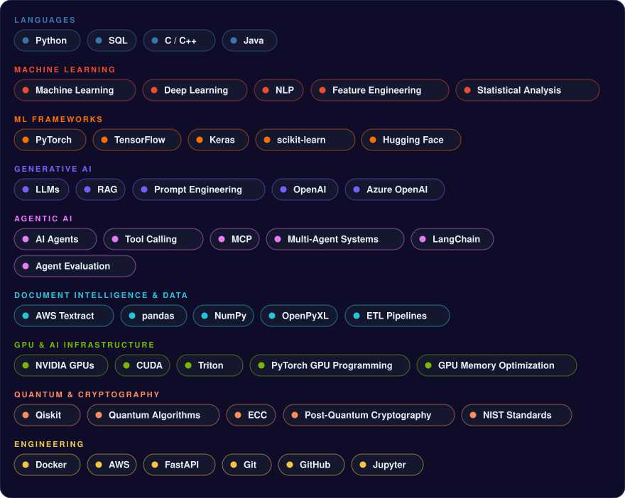
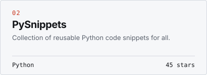
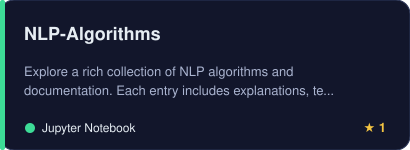

  

&nbsp;&nbsp;&nbsp;&nbsp;

 

## About

*Research-driven thinking. Engineering-oriented execution.*

- 💼 **AI/ML Research Engineer at M3AI** (2026 to present), building AI-powered financial analysis for commercial real estate: document extraction with AWS Textract and LLMs, plus reconciliation and validation of rent roll and cash flow data
- 🎓 B.Tech in AI & ML, VIPS-TC (GGSIPU), **9.2 CGPA**, university rank 25
- 🤖 Building **LLM agents** and evaluation frameworks (DungeonLM, Verity)
- ⚡ Exploring **GPU and AI infrastructure**, evaluation and reliability frameworks, and **post-quantum cryptography** with Qiskit
- 🔓 Open to research collaborations and engineering roles

## Research & Recognition

- 📄 **Published at Springer and AIP:** EEG brain activity classification (ICDAM 2024), piezoelectric materials for renewable energy (IC-AMSI 2024), BELKA binding affinity prediction (ICAMSI 2024)
- 🥉 **NeurIPS BELKA** bronze, 118th of 1,946 participants, and Kaggle top 10%
- 🛡️ **Cyber Security Grand Challenge 2.0** winner (idea stage)

## Stack

## Featured Projects

<!--START_SECTION:projects-->
<table><tr>
<td width="50%"></td>
<td width="50%"></td>
</tr><tr>
<td width="50%"></td>
<td width="50%"></td>
</tr></table>
<!--END_SECTION:projects-->

## Recent Activity

<!--START_SECTION:activity-->
- Merged PR [#4](https://github.com/UTSAVS26/AgentPulse/pull/4) in [AgentPulse](https://github.com/UTSAVS26/AgentPulse) · 7d ago
- Opened PR [#4](https://github.com/UTSAVS26/AgentPulse/pull/4) in [AgentPulse](https://github.com/UTSAVS26/AgentPulse) · 7d ago
- Merged PR [#3](https://github.com/UTSAVS26/AgentPulse/pull/3) in [AgentPulse](https://github.com/UTSAVS26/AgentPulse) · 8d ago
- Opened PR [#3](https://github.com/UTSAVS26/AgentPulse/pull/3) in [AgentPulse](https://github.com/UTSAVS26/AgentPulse) · 8d ago
- Merged PR [#2](https://github.com/UTSAVS26/AgentPulse/pull/2) in [AgentPulse](https://github.com/UTSAVS26/AgentPulse) · 9d ago
- Opened PR [#2](https://github.com/UTSAVS26/AgentPulse/pull/2) in [AgentPulse](https://github.com/UTSAVS26/AgentPulse) · 9d ago
<!--END_SECTION:activity-->

## GitHub, live

 

<picture>
  <source media="(prefers-color-scheme: dark)" srcset="https://raw.githubusercontent.com/UTSAVS26/UTSAVS26/output/snake.svg"/>
  
</picture>

Everything above is generated by GitHub Actions in this repo. Happy to say hi: research collaborations and open source welcome.

