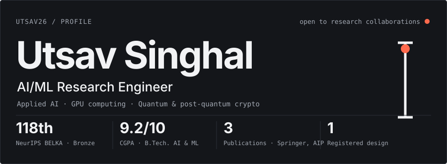
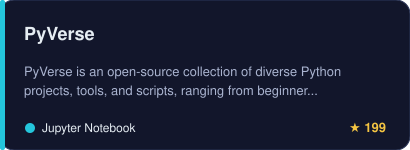
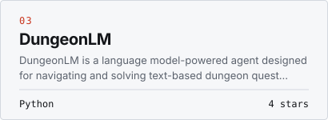
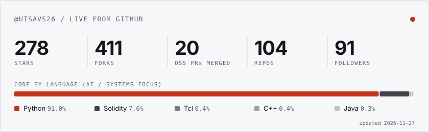
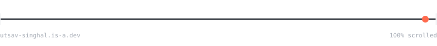

I build intelligent systems and research-driven engineering solutions, working across applied AI, computational systems and emerging technologies. I like turning hard research problems into practical, reusable systems.

**[Portfolio](https://utsav-singhal.is-a.dev)** · **[CV](https://utsav-singhal.is-a.dev/Utsav_Singhal_CV.pdf)** · **[LinkedIn](https://www.linkedin.com/in/utsavsinghal2604/)** · **[ORCID](https://orcid.org/0009-0007-3272-7668)** · **[Kaggle](https://www.kaggle.com/utsavsinghal2604)**

- **AI/ML Research Engineer at M3AI.** Turning commercial real estate financial documents into structured, validated financial models, with AWS Textract, LLM extraction and deterministic reconciliation.
- **On the side:** Verity (reliability of research code) and GPU Engine (memory-efficient kernels in Triton).

- **Exploring Human Brain Activity Classification**  
  ICDAM 2024 · Springer LNNS
- **Transforming Renewable Energy: Piezoelectric Substances**  
  IC-AMSI 2024 · Springer Proceedings in Energy
- **Unlocking drug discovery potential with BELKA**  
  AIP Conference Proceedings, Vol. 3362
- **Digital Device for Vedic Knowledge Analysis**  
  Registered design No. 447520-001 · June 2025

| | |
| :-- | :-- |
| **Languages** | `Python` `SQL` `C/C++` `Java` |
| **AI / ML** | `PyTorch` `TensorFlow` `scikit-learn` `LLMs` `RAG` |
| **Document AI** | `AWS Textract` `Azure OpenAI` `Pandas` `OpenPyXL` |
| **GPU** | `Triton` `NVIDIA GPUs` `Memory optimization` |
| **Quantum & crypto** | `Qiskit` `ECC` `PQC` `NIST standards` |
| **Ship** | `Docker` `AWS` `FastAPI` `Git` |

<!--START_SECTION:projects-->
<table><tr>
<td width="50%"></td>
<td width="50%"></td>
</tr><tr>
<td width="50%"></td>
<td width="50%"></td>
</tr></table>
<!--END_SECTION:projects-->

Projects, the stats card and the snake are generated by GitHub Actions in this repo.

Email [utsavsinghal26@gmail.com](mailto:utsavsinghal26@gmail.com) for research collaborations, engineering roles or open-source work.

